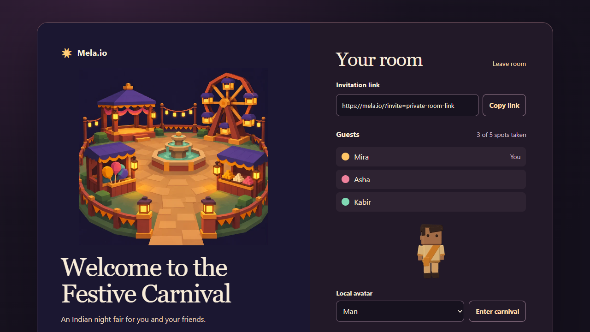
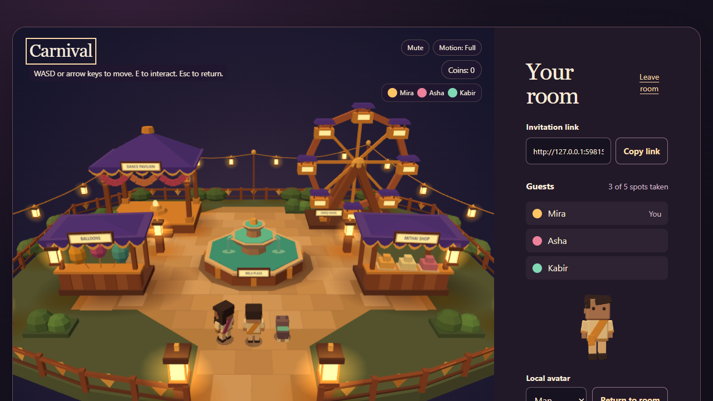
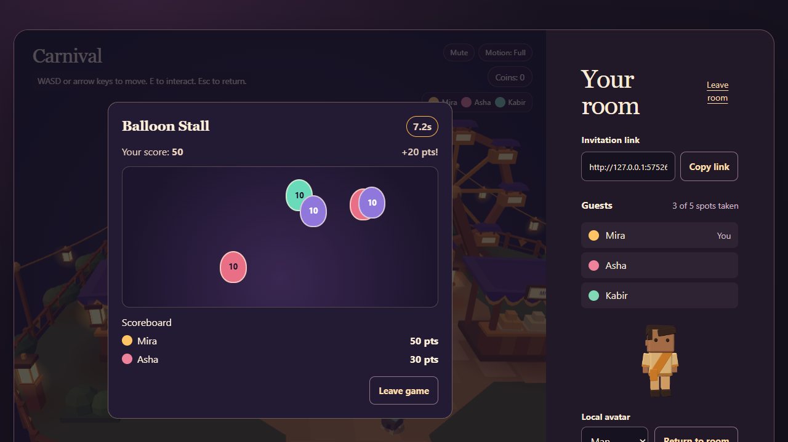
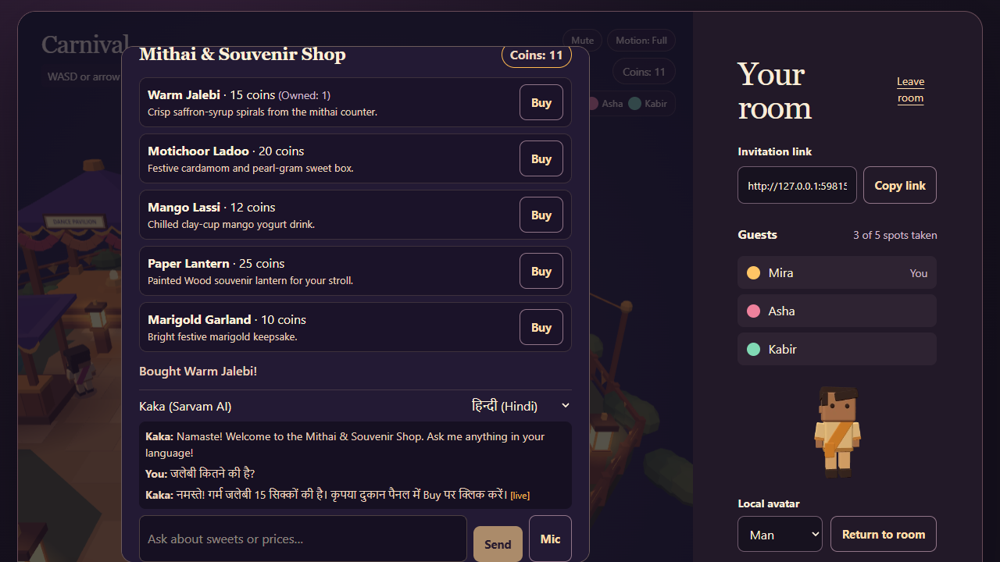
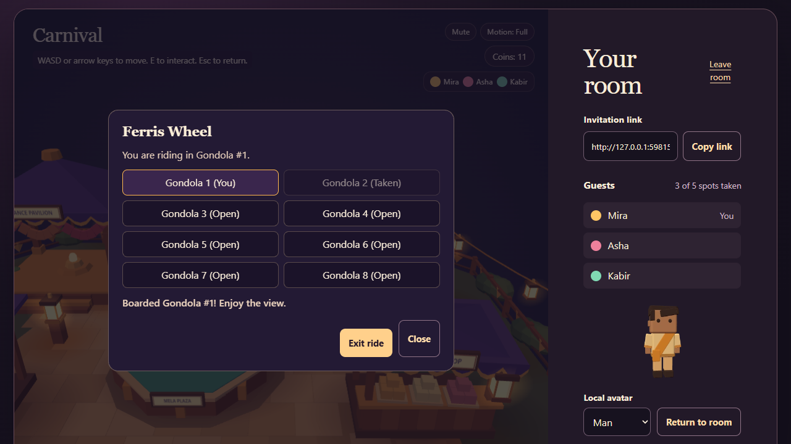
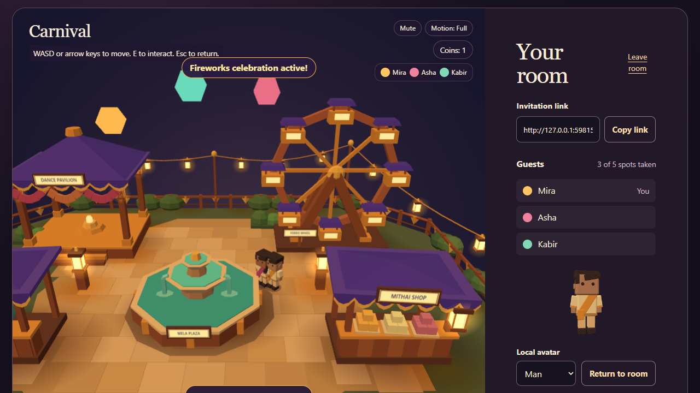

# MelaQuest

**Step into a cozy 3D Indian night fair (*mela*) with up to five friends — right in your browser.**

Create a private room, share one invite link, pick a **Man**, **Woman**, or **Cat** avatar, and explore a lantern-lit carnival together. Pop balloons to win coins, chat with **Kaka** at the Mithai Shop in your own language, ride the Ferris wheel, and pool coins at the fountain to launch fireworks across everyone's sky.

---

## Demo Video (with Voiceover)

> Watch 3 players (`Mira`, `Asha`, and `Kabir`) join one room, play Balloon Stall together, chat in Hindi with live **Sarvam AI**, buy Warm Jalebi, board the Ferris wheel, and trigger shared fireworks.

| Watch on YouTube |
| :---: |
| [](https://youtu.be/w0q97w0jisA?si=T7ah9R2-Z_ETPvCJ) |
| **[▶ Watch MelaQuest Demo on YouTube](https://youtu.be/w0q97w0jisA?si=T7ah9R2-Z_ETPvCJ)** |

<video src="docs/media/mela-demo.mp4" controls muted playsinline width="100%"></video>

If the inline video player does not render in your viewer, watch on **[YouTube](https://youtu.be/w0q97w0jisA?si=T7ah9R2-Z_ETPvCJ)** or open **[`docs/media/mela-demo.mp4`](docs/media/mela-demo.mp4)** directly. See **[the 60-second demo script](docs/SPONSOR-DEMO.md)** for the full storyboard.

---

## Screenshots

| Invite & Room Roster | Exploring Together in 3D |
| --- | --- |
|  |  |
| **1. Private Room:** Share one link with up to 5 friends and pick your avatar & color. | **2. Meet at the Plaza:** Walk around together and see every friend move in real time. |

| Balloon Pop Mini-Game | Mithai Shop & Sarvam AI (Hindi) |
| --- | --- |
|  |  |
| **3. Balloon Stall:** Pop festive balloons in a timed round to earn carnival coins. | **4. Mithai Shop:** Ask Kaka about sweets in Hindi (or other Indian languages) and buy treats. |

| Ferris Wheel Ride | Shared Fireworks Finale |
| --- | --- |
|  |  |
| **5. Ferris Wheel:** Pick an open gondola and ride together above the fairground. | **6. Fountain Fireworks:** Pool 20 coins as a group to light up the sky for the whole room. |

---

## What You Can Do

- **Private Rooms for Friends:** Create a room in one click (up to 5 players, no sign-up needed) and share the invite link.
- **Play Together in 3D:** Choose **Man**, **Woman**, or **Cat** in Marigold, Rose, Mint, or Indigo, and stroll around the plaza.
- **Win Coins at the Balloon Stall:** Pop balloons before they float away and compare scores on the shared room scoreboard.
- **Visit Kaka's Mithai Shop:** Spend coins on *Warm Jalebi*, *Motichoor Ladoo*, *Mango Lassi*, *Paper Lanterns*, or *Marigold Garlands* — and chat with Kaka by typing or using your microphone.
- **Ride & Celebrate:** Reserve gondolas on the Ferris Wheel, then chip in at the Plaza Fountain to set off fireworks everyone watches together.
- **Comfort Controls:** Toggle **Mute** or **Reduced Motion** anytime from the top-right HUD.

## Controls

| Key / Action | What it does |
| --- | --- |
| `W A S D` or Arrow Keys | Walk around the fairground |
| `E` (or click the prompt) | Open a nearby stall, shop, ride, or fountain |
| `Esc` | Close an open shop/game window, or return to the room panel |

---

## How Sponsor Products Power MelaQuest

- **Sarvam AI ([`src/integrations/sarvam.mts`](src/integrations/sarvam.mts)):** Powers **Kaka**, the multilingual Mithai Shopkeeper, across English, Hindi, Tamil, Bengali, Telugu, and Marathi using live chat (`sarvam-105b-conversations`), speech-to-text (`saaras:v3`), and text-to-speech (`bulbul:v3`), with safe mock fallback when no API key is set.
- **Flagsmith ([`src/integrations/flagsmith.mts`](src/integrations/flagsmith.mts)):** Controls live attraction availability (`balloon_game`, `ferris_wheel`, `ai_shopkeeper`, `fireworks`) and live event promos (`double_rewards` for 2× Balloon Stall coins) without redeploying, including an optional self-hosted Docker Compose profile.
- **NudgeBee / Observability ([`app/api/metrics/route.ts`](app/api/metrics/route.ts)):** Exposes structured runtime readiness (`/api/health`) and Prometheus-compatible gameplay & sponsor counters (`/api/metrics`) ready for monitoring and incident triage.

---

## Run It Yourself

All you need is **Docker Desktop** running on your machine:

```sh
cp .env.example .env
docker compose up --build -d
```

1. Wait a few seconds until `docker compose ps` shows the app as **healthy**.
2. Open **`http://127.0.0.1:3000`** in Chrome or Edge.
3. Create a room, copy the invite link, and open it in 2–3 separate browser profiles or incognito windows to play together!
4. Stop anytime with `docker compose down`.

*(Optional)* Add your `SARVAM_API_KEY` or `FLAGSMITH_ENVIRONMENT_KEY` to `.env` with `SPONSOR_MODE=live`, or start self-hosted Flagsmith locally with `docker compose --profile flagsmith up -d`.

---

## Project & Technical Docs

- [60-Second Demo Script](docs/SPONSOR-DEMO.md)
- [Checkpoint Progress Ledger](docs/PROGRESS.md)
- [Product & Protocol Specs](docs/SPECS.md)
- [Architecture Decisions](docs/DECISIONS.md)
- [Testing & Verification](docs/TESTING.md)
- [Assets & Attribution](docs/ASSETS.md)
- [Deployment & Runtime](docs/DEPLOYMENT.md)
